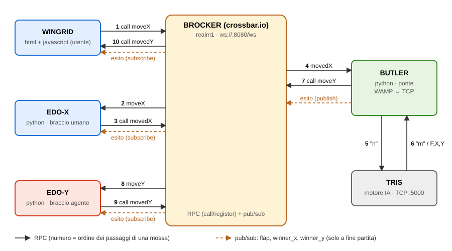

# Report di implementazione

Realizzazione di quanto descritto in [README.md](README.md): una partita a Tris tra un utente e un agente IA (simulato), giocata fisicamente da due bracci robotici e.DO (reali tramite l'SDK `pyedo`, oppure simulati se non e' configurato il loro IP).

## 1. Elementi in gioco



| Elemento | Cartella | Tecnologia | Ruolo |
|---|---|---|---|
| **WINGRID** | `actor/wingrid` | HTML + JavaScript, `autobahn.min.js` (incluso nel repo) | Mostra il campo (X dell'umano, cerchio dell'agente), raccoglie la mossa dell'utente, traccia la linea vincente e mostra l'esito (corona di alloro, grigio, pollice in su). Servito da un nginx su pc1; legge l'indirizzo del broker da `config.json`. |
| **BROCKER** | `broker/.crossbar` | crossbar.io (immagine `crossbario/crossbar`) | Router WAMP: instrada chiamate (RPC) e messaggi (pub/sub) tra gli attori. Un solo realm, `realm1`, ruolo `anonymous` con tutti i permessi. |
| **EDO-X** | `actor/edo-x` | Python 3.12, autobahn (asyncio), `pyedo` | Braccio dell'umano. Esegue `moveX`: chiede a FRAME le coordinate locali di pedina e cella, sposta la pedina, poi chiama `movedX`. Reagisce agli esiti. |
| **EDO-Y** | `actor/edo-y` | Python 3.12, autobahn (asyncio), `pyedo` | Braccio dell'agente. Esegue `moveY` (stessa sequenza con FRAME), poi chiama `movedY`. Reazioni opposte a EDO-X (tranne la patta). |
| **BUTLER** | `actor/butler` | Python 3.12, autobahn + asyncio streams | Traduce tra WAMP e il socket TCP di TRIS. |
| **FRAME** | `actor/frame` | Python 3.12, autobahn | Servizio accessorio: converte le coordinate globali di celle e pedine nelle coordinate locali di ciascun braccio. Configurazione in `field.json`. |
| **TRIS** | `actor/tris` | Python 3.12, asyncio (solo libreria standard) | Motore di gioco simulato: risponde con una casella libera a caso e riconosce vittorie e patta reali. |

Su pc1 girano WINGRID ed EDO-X, su pc2 il resto (oppure tutto su una macchina, vedi *Distribuzione su 2 host*). Il tutto e' orchestrato da [docker-compose.yml](../docker-compose.yml) (7 container con il profilo `all`: crossbar, tris, butler, edo-y, frame, wingrid, edo-x-local).

## 2. Pattern e scelte implementative

- **Broker / WAMP (RPC + publish/subscribe).** Nessun attore conosce gli altri: tutti parlano solo con crossbar. Chi vuole eseguire un'azione la *registra* (`register`), chi la vuole richiedere la *chiama* (`call`). Gli esiti di fine partita sono eventi (`publish`/`subscribe`) perche' interessano a piu' attori contemporaneamente.
- **Chi registra cosa** (ogni procedura ha un solo esecutore):

  | Procedura | Registrata da | Chiamata da |
  |---|---|---|
  | `com.tris.moveX(n)` | EDO-X | WINGRID |
  | `com.tris.movedX(n)` | BUTLER | EDO-X |
  | `com.tris.moveY(n)` | EDO-Y | BUTLER |
  | `com.tris.movedY(n)` | WINGRID | EDO-Y |
  | `com.tris.localCell(arm, n)` | FRAME | EDO-X, EDO-Y |
  | `com.tris.localPiece(arm, n)` | FRAME | EDO-X, EDO-Y |

  | Topic | Pubblicato da | Sottoscritto da |
  |---|---|---|
  | `com.tris.flap`, `com.tris.winner_x`, `com.tris.winner_y` | BUTLER | WINGRID, EDO-X, EDO-Y |

- **Handler "risposta subito, lavoro dopo".** `moveX`, `moveY` e `movedX` rispondono immediatamente al chiamante e avviano il lavoro vero (movimento del braccio, interrogazione di TRIS) in un task asincrono (`asyncio.ensure_future`). In questo modo nessuna `call` resta appesa per tutta la durata di un movimento e non si hanno timeout di RPC.
- **Adapter / ponte (BUTLER).** Isola il protocollo di TRIS (testo su TCP) dal resto del sistema, che parla solo WAMP. Un `asyncio.Lock` serializza le richieste verso TRIS.
- **Protocollo TRIS.** Una riga di testo per messaggio. Ricevi `1..9`; rispondi `1..9` (mossa di Y), `X` / `F` se la mossa dell'umano chiude la partita, `n Y` / `n F` se la chiude la mossa `n` di Y (cosi' EDO-Y posa comunque l'ultima pedina). Una mossa non valida riceve `ERR`. Ogni connessione TCP e' una partita.
- **Ultima mossa di Y.** Su `n Y` / `n F` BUTLER chiama `moveY(n)` e pubblica l'esito con argomento `n`. EDO-Y esegue le azioni del braccio una alla volta e nell'ordine di arrivo, quindi prima posa la pedina e poi esulta; WINGRID mostra l'esito solo dopo `movedY(n)`.
- **Nuova partita.** All'apertura della pagina e su "Nuova partita" WINGRID pubblica `com.tris.new_game`: BUTLER si ricollega a TRIS (partita nuova anche se la pagina e' stata ricaricata a meta'), EDO-X ed EDO-Y ripartono dalla pedina 1. Le pedine sul campo vanno tolte a mano. "Nuova partita" e' disattivato mentre i bracci si muovono. WINGRID registra `movedY` con `force_reregister`: l'ultima finestra aperta prende il controllo, quindi ricaricare la pagina funziona sempre, anche se la sessione precedente non si e' chiusa (pagina nella cache del browser, rete caduta).
- **Coordinate locali.** I bracci non conoscono il piano globale: per ogni mossa chiedono a FRAME le coordinate locali di pedina e cella (vedi *Coordinate locali*).
- **Bracci e.DO.** EDO-X ed EDO-Y condividono il codice in `actor/edo-common/edo.py` (per questo il loro build context in compose e' `./actor`). La classe `Arm` ha i metodi `place_piece` (riceve gia' le coordinate locali), `celebrate`, `sad`, `salute`: se `config.json -> edo.<braccio>.ip` (o `EDO_IP`) e' impostato li esegue sul robot con la classe `Robot` (SDK `pyedo`, chiamate bloccanti eseguite in un thread con `asyncio.to_thread`), altrimenti scrive nel log e attende 2 secondi. `place_piece` apre la pinza, scende sulla pedina a `pick_z`, la chiude, sale a `safe_z`, scende sulla cella a `place_z`, apre e torna in home (`moveToHome`, braccio verticale): cosi' mentre un braccio gioca l'altro e' sempre in home. Le coordinate locali di FRAME (x verso destra, y in avanti) diventano quelle della base e.DO (x in avanti, y a sinistra). I gesti di esultanza, tristezza e saluto sono movimenti di giunti di ampiezza moderata, da provare la prima volta a bassa velocita'. Nel container `pynput` (usato da `pyedo` per l'arresto con il tasto `k`) gira con il backend `dummy`: all'avvio compare un `NotImplementedError` del suo thread, innocuo.
- **Avvio senza Docker.** Da `actor/edo-x`: `PYTHONPATH=../edo-common python edo_x.py` (dipendenze in `actor/edo-common/requirements.txt` piu' `pynput`); legge `config.json` dalla radice del repo.
- **Avvio ordinato.** crossbar ha un `healthcheck` (porta 8080 in ascolto); butler, edo-y e frame (e, nel profilo `all`, edo-x-local) partono solo quando e' `healthy`. Su pc1 EDO-X non puo' aspettarlo (il broker e' su un altro host): `restart: on-failure` lo rilancia finche' il broker non e' raggiungibile. Vale anche per gli altri attori se la connessione cade all'avvio.
- **Librerie.** `autobahn[asyncio]==24.4.2` (client WAMP Python, backend asyncio); `autobahn-browser 22.10.1` (client WAMP nel browser); `asyncio` della libreria standard per TCP e concorrenza.

### Coordinate locali (FRAME)

`actor/frame/field.json` contiene, per ogni braccio, le coordinate X, Y (mm) **lette dall'app e.DO**: si porta la pinza sopra il punto con il movimento manuale e si copiano le cartesiane (X in avanti, Y a sinistra). Servono `grid` (centro della casella 5 e centro della casella 1; le altre 7 celle sono calcolate, griglia quadrata) e `pieces` (le 5 pedine da prendere). Niente metro e niente punto zero comune: ogni braccio si sposta reinsegnando solo i suoi punti, e le piccole imprecisioni del robot sono gia' comprese. FRAME restituisce comunque il piano locale (x a destra, y in avanti), che EDO-X/EDO-Y riconvertono per `moveCartesian`. Con lo stesso metodo conviene leggere la Z con la pinza all'altezza di presa e di rilascio e usarla per `pick_z` e `place_z`. Resta supportato il formato globale (`cells` o `grid` alla radice, e per ogni braccio `origin`, `left`, `right` e pedine in coordinate del tavolo): x locale = direzione left -> right, y locale = x ruotato di 90 gradi antiorario, origine = `origin`. Il file e' montato come volume e riletto a ogni richiesta: per spostare un braccio basta modificarlo.

Su `moveX(3)` EDO-X: sceglie la prossima pedina (1..5), chiede `localPiece("EDO-X", p)` e `localCell("EDO-X", 3)`, sposta la pedina, poi chiama `movedX(3)`. La geometria pura e' in `actor/frame/frame.py` (classi `Frame`, `Field`).

### Distribuzione su 2 host

| Host | Attori | Profilo compose |
|---|---|---|
| pc1 (utente) | WINGRID (nginx, porta 8880), EDO-X | `pc1` |
| pc2 | crossbar, BUTLER, EDO-Y, FRAME, TRIS | `pc2` |
| unico | tutti | `all` (EDO-X diventa `edo-x-local`, che raggiunge il broker nella rete compose) |

Gli unici collegamenti tra host sono: pc1 -> broker (WebSocket, dal browser e da EDO-X) e pc2 -> motore di gioco (TCP, da BUTLER). I loro indirizzi stanno in `config.json` (sezioni `broker` e `tris`), vedi [README](../README.md). BUTLER parla o con il TRIS simulato (container su pc2, `tris.host: "tris"`) o con un motore esterno su un'altra macchina (`tris.host` / `tris.port` = IP e porta del motore; per non avviare il simulatore: `--scale tris=0`). Nel grafico l'alternativa e' il blocco tratteggiato "TRIS esterno". WINGRID non e' piu' servita da crossbar ma da un nginx su pc1, che pubblica anche `config.json` perche' il browser sappia dove collegarsi.

## 3. Come avviare il test

Prerequisito: Docker con Compose.

```
docker compose --profile all up --build
```

(per i due host: `--profile pc1` e `--profile pc2`, vedi README). Poi aprire WINGRID nel browser: **http://localhost:8880** (`WINGRID_PORT` in `.env`). Il broker e' pubblicato su `BROKER_PORT` (8090): se la porta e' occupata da un altro crossbar si ottiene "No Such Resource"; cambiare `BROKER_PORT` e `broker.port` in `config.json`.

Svolgimento:

1. Clicca una casella: compare una `X` sbiadita mentre EDO-X posa la pedina (2 s in simulazione).
2. Poi EDO-Y posa la sua pedina e compare un cerchio.
3. Si ripete finche' qualcuno fa tris o il campo e' pieno: WINGRID traccia la linea vincente e mostra corona di alloro (vince X), grigio (vince Y) o pollice in su (patta); i robot reagiscono.
4. "Nuova partita" azzera il campo e la partita in TRIS.

Per fermare tutto: `docker compose down`.

## 4. Come seguire il passaggio delle informazioni

### Log di tutti gli attori insieme

```
docker compose --profile all logs -f edo-x-local butler tris edo-y frame
```

Con l'avvio su 2 host: su pc1 `docker compose --profile pc1 logs -f edo-x`, su pc2 `docker compose --profile pc2 logs -f butler tris edo-y frame`.

Per una mossa dell'utente sulla casella 5 si vede, nell'ordine (numeri del grafico):

```
frame   | [FRAME] EDO-X: pedina 1 -> (-200.0, 100.0)               <- 2-3 (moveX ricevuta, EDO-X chiede a FRAME la pedina)
frame   | [FRAME] EDO-X: cella 5 -> (0.0, 300.0)                    <- 3 (e la cella)
edo-x   | [EDO-X] prelevo la pedina 1 in (...) e la poso sulla casella 5 in (...)   <- 3 (movimento eseguito)
edo-x   | [EDO-X] pedina posata in 5, torno a riposo
butler  | [BUTLER] -> TRIS: 5                                       <- 4-5 (movedX -> BUTLER)
tris    | [TRIS] umano (X) -> 5                                    <- 6
tris    | [TRIS] agente (Y) -> 2
butler  | [BUTLER] <- TRIS: 2                                       <- 7
frame   | [FRAME] EDO-Y: pedina 1 -> (...) / cella 2 -> (...)       <- 8-10 (moveY, poi EDO-Y chiede a FRAME pedina e cella)
edo-y   | [EDO-Y] prelevo la pedina 1 in (...) e la poso sulla casella 2 in (...)
edo-y   | [EDO-Y] pedina posata in 2, torno a riposo               <- 11 (poi movedY -> WINGRID, 12)
```

A fine partita `[TRIS] partita finita, esito: ...`, poi `[BUTLER] <- TRIS: F|X|Y` e le reazioni `ESULTO` / `mi deprimo` / `saluto` dei due bracci.

### Console del browser

Aprire gli strumenti di sviluppo (F12) sulla pagina WINGRID: la scheda *Network → WS* mostra i messaggi WAMP scambiati (`CALL`, `INVOCATION`, `RESULT`, `EVENT`...). La scheda *Console* mostra eventuali errori (per esempio `no_such_procedure` se un attore non e' ancora registrato).

### Log del broker

```
docker compose logs -f crossbar
```

Mostra le sessioni collegate (una per WINGRID, EDO-X, EDO-Y, BUTLER, FRAME).

### Chiamare il sistema senza interfaccia

Si puo' simulare l'utente senza browser chiamando `com.tris.moveX` da un qualunque client WAMP sul realm `realm1` all'indirizzo `ws://localhost:<BROKER_PORT>/ws`; il resto della catena si osserva nei log come sopra.

## 5. Limiti noti

- TRIS e' una simulazione: sceglie la mossa a caso tra le caselle libere (vittorie e patta sono quelle reali).
- Le quote (`safe_z`, `pick_z`, `place_z`) e la posizione dei bracci in `field.json` vanno misurate sul campo vero; i bracci reali non sono stati provati in questo repository.
- Tolte le pedine dal campo, a fine partita vanno rimesse a mano nei punti di prelievo.
- Il broker e' aperto (ruolo `anonymous` con tutti i permessi): adatto a una dimostrazione locale, non a un ambiente esposto.
- WINGRID si collega con `ws://` (non `wss://`) all'indirizzo di `config.json`: nessuna cifratura sul tratto pc1 -> pc2.
- La griglia e' calcolata da 2 punti: deve essere quadrata e regolare, e un errore sul centro raddoppia sulle caselle d'angolo. Se non lo e', si elencano le 9 celle con il formato globale (`cells`).
- Il numero di pedine per braccio e' fisso a 5 (`PIECES` in `edo_x.py` / `edo_y.py`).
